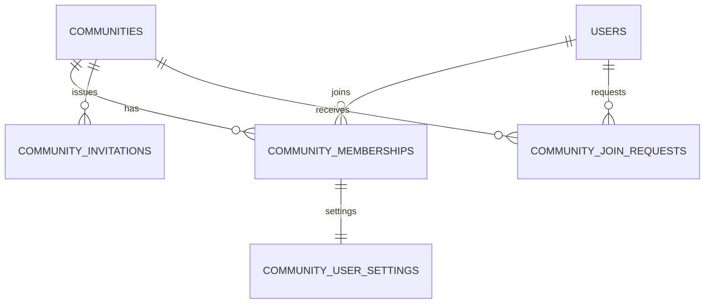

# Community物理データモデル

## 概要

Community domainが所有するPostgreSQL table、column、PK、FK、index、削除規則を定義します。

## PostgreSQL schema

本domainが所有するrelationは`community` schemaへ配置します。schema名と共通の参照規約は[物理データモデル共通規約](/system/data/physical-model-conventions)を正本とします。

## 共通規約

ID、日時、命名、constraint、index、削除方針は[物理データモデル共通規約](/system/data/physical-model-conventions)に従います。本ページではCommunity domain固有の定義と例外を記載します。

## 全体ER

## 所有table

### communities

| 列 | 型 | 制約 | 意味 |
| --- | --- | --- | --- |
| id | varchar(26) | PK | Community ID |
| name | text | NOT NULL、前後空白除去後に空でない | 表示名。同名を許可 |
| status | varchar(16) | NOT NULL、CHECK | `ACTIVE` / `DELETING` |
| created_at | timestamptz | NOT NULL | 作成時刻 |
| updated_at | timestamptz | NOT NULL | 更新時刻 |

説明、作成者、親Communityは保持しません。通常操作は`ACTIVE`だけを対象とし、削除受付時に`DELETING`へ遷移します。`DELETING`から`ACTIVE`へ戻す復元操作は提供しません。

### community_memberships

| 列 | 型 | 制約 | 意味 |
| --- | --- | --- | --- |
| community_id | varchar(26) | FK communities ON DELETE CASCADE | 所属先 |
| user_id | varchar(26) | FK users ON DELETE RESTRICT | 参加User |
| role | varchar(16) | NOT NULL、CHECK | `member` / `admin` |
| joined_at | timestamptz | NOT NULL | 参加時刻 |

PKは`(community_id, user_id)`です。Userが参加しているCommunityのlookup用に`(user_id, community_id)`へindexを追加します。Community内のMember一覧はScreen Specificationに従って既定を現在のnickname順とし、名前またはroleの単一column sortを提供します。参加日時はInitial Releaseの表示・sort契約に使用しません。nicknameはUser domainが所有するため、Community Membership単独の`joined_at` indexをUI一覧順の正本にはしません。cross-domain queryとcursorは[GraphQL契約](/system/api/graphql)を正本とし、Query ServiceがMembershipと現在User Profileをjoinして `NAME` / `ROLE` のkeyset paginationを実行します。nicknameはUser domain所有のためCommunity tableへ複製しません。初期Releaseでは実測なしに冗長なcross-schema indexを追加せず、Membershipの `(community_id, user_id)` PKとUser PKを基礎にquery planを検証し、必要性が確認されたindexだけmigrationで追加します。Administrator専用tableは設けず、`role = 'admin'`のMembershipがAdministrator権限を表します。Communityごとに1人以上の`admin`を維持する条件は、Community行lockとService transactionで保証します。退会・User削除時は共有解除や最終Administrator確認が必要なため、User参照は`ON DELETE RESTRICT`とします。User削除flowでは必要なCommunity / Media cleanupを完了してMembershipを明示削除した後にUserを物理削除します。

### community_user_settings

| 列 | 型 | 制約 | 意味 |
| --- | --- | --- | --- |
| community_id | varchar(26) | PKの一部、FK | 対象Community |
| user_id | varchar(26) | PKの一部、FK | 対象User |
| accent_color | varchar(7) | NOT NULL、CHECK | User × Community Accent。大文字 `#RRGGBB` |
| created_at | timestamptz | NOT NULL | 作成時刻 |
| updated_at | timestamptz | NOT NULL | 更新時刻 |

PKは `(community_id, user_id)` とし、同じ複合keyで `community_memberships(community_id, user_id)` を参照して `ON DELETE CASCADE` とします。これによりsettingはMembership lifecycleへ従属し、退会・除外時に同時削除されます。再参加時は過去recordを復元せず、新しい初期Accentを生成します。

AccentはApplicationで `#RRGGBB` へ正規化し、DBでも `^#[0-9A-F]{6AccentはApplicationで `#RRGGBB` へ正規化し、DBでも `^#[0-9A-F]{6}$` 相当のCHECKで形式を防御します。Community作成時とInvitation参加成立時はMembership作成と同じTransaction内でsettingを作成し、Membershipだけ存在してsettingが欠落するcommitを許可しません。

初期AccentはHSLで生成します。Hueは `0 <= H < 360`、Saturationは55–75%、Lightnessは40–60%から一様乱数で選び、RGBへ変換して大文字 `#RRGGBB` として保存します。同一Userが現在Membershipを持つ他CommunityのAccentとの完全一致だけを衝突として扱い、類似色は許容します。衝突時は最大10回random生成を再試行します。10回すべて衝突した場合は最後の候補を起点にHueを決定的にずらし、現在使用中のAccentと完全一致しない値を選ぶfallbackを使用します。乱数衝突だけを理由にCommunity作成・参加Transactionを失敗させません。暗号学的乱数は要件としません。

### community_invitations

| 列 | 型 | 制約 | 意味 |
| --- | --- | --- | --- |
| id | varchar(26) | PK | 招待ID |
| community_id | varchar(26) | FK communities ON DELETE CASCADE | 招待対象Community |
| token_hash | varchar(128) | NOT NULL、UNIQUE | 推測困難なtokenの検証用hash |
| token_ciphertext | text | NOT NULL | versioned envelope形式のAES-256-GCM暗号文（base64url） |
| token_key_id | varchar(128) | NOT NULL | 復号鍵の非秘密識別子 |
| token_nonce | varchar(32) | NOT NULL | 暗号化ごとに生成する96-bit nonceのbase64url表現 |
| created_by_user_id | varchar(26) | FK users ON DELETE SET NULL | 発行Administrator |
| created_at | timestamptz | NOT NULL | 発行時刻 |
| expires_at | timestamptz | NOT NULL | 発行から7日後 |
| revoked_at | timestamptz | NULL可 | 無効化時刻 |

tokenの暗号文はApplication側で暗号化・復号し、復号可能な秘密鍵をDBに保存しません。暗号鍵識別子・暗号方式・rotation時の既存token復号と再暗号化・アクセス監査の詳細はSecurity / API設計で確定します。token hashによるInvitation accept検証は維持し、URL再表示のための復号は現在のAdministrator権限を検証した場合に限定します。

`revoked_at IS NULL`を条件とするCommunity単位のpartial unique indexで、失効処理されていない招待URLを1件に制限します。期限切れURLは再発行Transaction内で`revoked_at`を設定してから新規行を作成します。期限判定に現在時刻を使うpartial indexは作成しません。

Initial ReleaseのInvitation acceptは有効なInvitationを検証し、`community_memberships(role='member')`を同じTransactionで直接作成します。Invitation自体に使用済み状態を表すcolumnは持たせず、有効期間内は複数Userが同じURLを利用できます。Join RequestをInvitation acceptの中間relationとして作成しません。

### community_join_requests

`community_join_requests`はInvitation acceptとは独立したUser起点Join Requestの将来機能です。以下の論理・物理設計は将来実装時のbaselineとして保持しますが、Initial ReleaseではUI/APIを提供せず、`00001_initial.sql`にもtableを作成しません。機能実装時に要件を再確認し、その時点のversioned migrationで追加します。

| 列 | 型 | 制約 | 意味 |
| --- | --- | --- | --- |
| id | varchar(26) | PK | 申請ID |
| community_id | varchar(26) | FK communities ON DELETE CASCADE | 参加申請先 |
| applicant_user_id | varchar(26) | FK users ON DELETE CASCADE | 申請者 |
| status | varchar(16) | NOT NULL、CHECK | `PENDING`、`APPROVED`、`REJECTED`、`CANCELLED`、`INVALIDATED` |
| requested_at | timestamptz | NOT NULL | 申請時刻 |
| reviewed_by_user_id | varchar(26) | FK users ON DELETE SET NULL | 承認・拒否Administrator |
| reviewed_at | timestamptz | NULL可 | 承認・拒否時刻 |
| resolved_at | timestamptz | NULL可 | 確定・取消し・無効化時刻 |

statusとreview / resolve情報は次の整合条件を持ちます。

| status | reviewed_by_user_id | reviewed_at | resolved_at |
| --- | --- | --- | --- |
| `PENDING` | NULL | NULL | NULL |
| `APPROVED` | 承認時は必須。後のUser削除でNULL可 | NOT NULL | NOT NULL |
| `REJECTED` | 拒否時は必須。後のUser削除でNULL可 | NOT NULL | NOT NULL |
| `CANCELLED` | NULL | NULL | NOT NULL |
| `INVALIDATED` | NULL | NULL | NOT NULL |

DBではstatusに応じた`reviewed_at` / `resolved_at`のNULL整合をCHECK constraintで保証します。`reviewed_by_user_id`は履歴上のreviewerを表しますが、User物理削除時に`ON DELETE SET NULL`となるため、`APPROVED` / `REJECTED`の保存状態に対してNOT NULLを要求しません。承認・拒否transaction実行時にreviewer Userが存在することはServiceで保証します。

`status = 'PENDING'`を条件に`(community_id, applicant_user_id)`へpartial unique indexを設定し、重複申請を防ぎます。申請User削除時は先に`INVALIDATED`へ更新して並行する承認を防止し、User物理削除時に`ON DELETE CASCADE`でJoin Request自体を削除します。User削除後まで申請履歴を保持する要件は設けません。承認待ち一覧は新しい申請から表示し、`requested_at DESC, id DESC`を安定したsortとします。`(community_id, status, requested_at DESC, id DESC)`のindexで取得します。

Media domainが所有する`media_custodies`と`media_community_accesses`は[Media物理データモデル](/media/physical-data-model)を参照します。

## 削除規則

Community削除受付時はCommunityを`DELETING`へ遷移させ、通常利用を停止したうえでMembership、Invitation、User起点Join Request、当該CommunityへのUser管理Media Access、Community scopeのGroup / Tagとそれらの従属relationを削除または無効化し、Community管理MediaをMedia削除Lifecycleへ移行します。`media_custodies.community_id`は`ON DELETE RESTRICT`を維持し、Community管理MediaのCustody参照が残る間はCommunity recordの物理削除を禁止します。すべてのCommunity管理Mediaが物理削除されCustody参照が解消した後にCommunityを物理削除します。User管理Media本体、User scopeの分類、他Communityへの共有は変更しません。Media domainのcleanupをFK cascadeだけで代替しません。

Membershipの退会・除外・User削除では、最後のAdministrator確認とUser管理Mediaの共有解除が必要なため、`users`からの単純なFK cascadeだけに依存しません。Invitationの発行者やJoin Requestのreviewerなど履歴上のUser参照は、User削除後に不要な個人情報を保持しないよう`ON DELETE SET NULL`またはUser domainの削除規則に従います。

Media domainが所有する`media_custodies`と`media_community_accesses`の削除規則は[Media物理データモデル](/media/physical-data-model)を正本とします。

## 他domainとの境界

`communities`、`community_memberships`、`community_invitations`、`community_join_requests`は本ページを設計上の正本とします。GraphQL・実行可能SQL schemaの正本は実装を所有する`memoria-api`です。

## Invitation token暗号化・鍵管理 Contract（Issue #238）

- tokenはCSPRNGで256-bit以上を生成し、URL-safe base64urlで表現する。token_hashはSHA-256等の一方向digest（既存実装と互換の方式をAPI実装時に確定）で検証し、平文tokenはDB・log・analytics・traceへ永続保存しない。
- AES-256-GCMを使用し、256-bitの暗号鍵と暗号化ごとに新規生成する96-bit nonceを使う。AADは固定version prefix、Community ID、Invitation IDを長さ区切りで正規化したbyte列とし、同じ方式で復号する。GCM authentication tagは128-bitとし、暗号文とともに保存する。
- `token_ciphertext`はversion付きのciphertext+tagをbase64urlで格納する。形式のversion、`token_key_id`、`token_nonce`を暗号化metadataとして扱う。DBのInvitation ID / Community IDとの不一致・認証tag不一致・未知versionは復号失敗とする。
- 鍵はDBと分離したsecret manager / KMSで管理し、Applicationには最小権限で復号を許可する。鍵そのもの・平文token・復号結果を監査logへ記録しない。鍵識別子・実行主体・操作結果・Invitation IDのみを監査対象とする。
- 鍵rotationでは新鍵をactive encryption keyに設定し、旧鍵をdecrypt-onlyとして保持する。既存Invitationを復号後、新nonceで新鍵へ再暗号化し、暗号文・key ID・nonceを同一rowの条件付き更新で原子的に置換する。期限切れ・失効済みのInvitationを再表示可能に戻さない。旧鍵削除は対象暗号文が残らず、復旧手順が検証された後に行う。
- 鍵喪失・復号失敗時はURLを推測・再発行・失効したことにせず、秘密情報を含まない内部エラーとして返す。運用者が調査できるよう秘密情報を除いたaudit eventを残す。URL再表示障害がInvitation acceptのhash検証を妨げない設計とする。
- Migrationは既存Invitation行の暗号文が存在しない場合を考慮する。復元できない既存tokenを生成したことにせず、移行期間のnullable列・再発行案内・制約強化の順序をAPI実装時に確定する。既存のInvitation URLを無断で失効させない。
