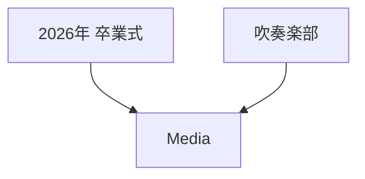
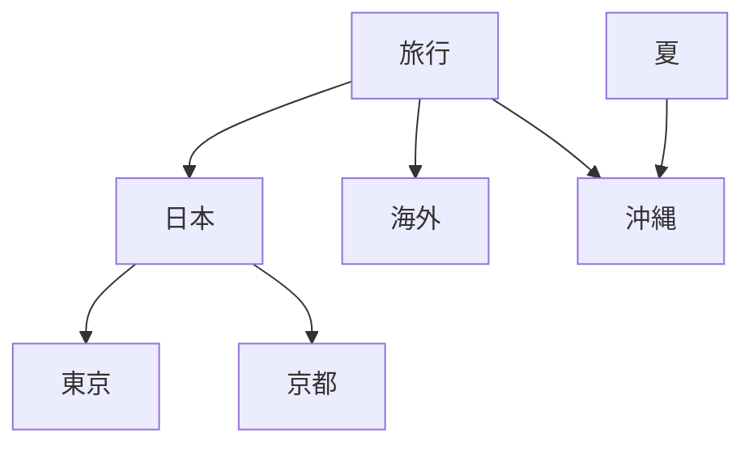

# Media Group

## 概要

> 実装状況: APIの実行可能なSchemaにはMedia GroupとGroup relationの定義があり、Groupの操作にも既存実装があります。Community scopeの権限や多段循環防止など、設計上の規則をすべて保証できているかは個別の実装・テストで確認してください。

## 目的

Media GroupはMediaを分類・整理するための概念です。学校Communityで「2026年 卒業式」「2025年 運動会」のようにMediaをまとめる用途を想定します。

Groupはfolderではありません。Group自身も別Groupへ所属でき、同じGroupが複数Groupへ所属できます。結果として階層的に見える場合はありますが、一意なtreeやpathを前提としません。

Groupは次の情報へ影響しません。

- MediaのCustodian
- Communityへの共有範囲
- Community内部の閲覧権限
- 物理fileの保存場所

## 所属範囲

GroupはUser scopeまたはCommunity scopeのどちらか一方だけに所属します。

- Userは自分のPersonal Groupを作成・管理できる
- Community Groupの分類体系はCommunityのAdministratorが管理する
- CommunityのAdministratorとMemberは、既存のCommunity Groupを使って閲覧可能なMediaを分類できる
- User間でGroupを共有しない
- Community間でGroupを共有しない
- UserとCommunityの間でGroupを共有しない
- User管理MediaをCommunityへ共有した場合も、Community内だけで有効なGroup関連を作成できる
- 共有解除・退会・除外時は当該CommunityのMediaとGroupの関連だけを削除し、Group本体は保持する

Community Groupでは「分類体系を管理すること」と「分類体系を利用すること」を分離します。AdministratorはGroupの作成・rename・削除・Group間relationの追加と解除を行えます。MemberはGroup構造を変更せず、既存Groupを使ったMedia分類だけを行えます。Group作成者という追加のownershipや権限概念は導入しません。

## Group名

Group名はscope内でGroupを識別する名称です。

- Group名は必須とする
- 入力時に前後のUnicode whitespaceを除去し、除去後が空文字の場合は拒否する
- 同一scope内で同じ保存名のGroupを複数作成できない
- Personal Groupは同一User scope、Community Groupは同一Community scopeで重複を禁止する
- 別scopeでは同じGroup名を許可する
- 大文字・小文字、全角・半角、内部の連続空白等をSystemが自動統合しない
- renameにも同じ名称規則と重複判定を適用する
- Group名はtrim後100文字以内とする。**文字数はUnicode拡張書記素クラスター（grapheme cluster）単位で数え、UTF-8 byte数・Unicode code point数では数えない**
- **元の入力文字列をtrimする前に**、Unicode `Cc`（改行、タブ、NUL等）、`Zl`（行区切り）、`Zp`（段落区切り）のいずれかが含まれれば拒否する。先頭・末尾にある禁止文字もtrimで消して受理せず、理由を示す。禁止文字がなければ前後のUnicode whitespaceをtrimし、残った文字列の名前制約を検証する。入力文字列を黙って改変して保存しない
- 作成とrenameの双方で同じ検証をFrontendとBackendが適用し、Backendを最終的な検証主体とする。Frontendの入力制限はBackendの検証を代替しない

100文字はGroupを一覧・検索・relation選択で人が識別する名称として十分な表現幅を確保しつつ、極端に長い名称をProductとして受け付けないための上限です。DB column幅やUI layoutから逆算した値ではなく、Product上の入力制約として扱います。作成とrenameの双方へ同じ上限を適用します。絵文字の結合列や結合文字を含む名前でも同じ書記素境界で数える必要があります。Unicode version差による分節結果の互換性は実装・テストの検討対象とします。`Cf`（ZWJ、ZWNJ、双方向制御など）は一律禁止せず、文字種・用途別の追加検討をIssue #296で進めます。単一行入力に共通する禁止文字と検証順序は[Unicode単一行入力ガイドライン](/guidelines/unicode-single-line-input)を正本とします。

## Mediaとの関係

1つのMediaは複数Groupへ所属できます。Media本体を複製せず、relationだけを追加します。

- 1つのGroupから除外しても他のGroup所属は維持する
- すべてのGroupから除外してもMedia本体は削除しない
- Groupを削除してもMedia本体は削除しない
- Media削除時はすべてのGroup関連を削除する

Media分類のrelation semanticsと権限は本設計を正本とします。Initial Releaseの具体的Interactionは[Media Browser / Detail](/screens/media-browser-detail)を正本とし、Media Detailでは1 Mediaのdirect Group relationを確認して追加・除外でき、Browserで明示選択した複数Mediaには1つ以上の同じ既存Groupを一括追加できます。Initial ReleaseではGroupからのbulk除外を主要Capabilityとしません。bulk追加でもMediaごとに現在scope・可視性・権限を再検証し、部分成功を許容します。

## Group同士の関係

Media Groupは有向非巡回グラフ（DAG）として扱います。同じGroupを複数の所属先Groupへ関連付けられますが、循環は許可しません。

Groupが複数の所属先を持てるため、Groupには一意なrootやbreadcrumb pathを定義しません。「日本 / 沖縄」のようなpathをGroupのidentityや正規Navigationとして扱いません。

### 制約

- relationは同一scopeのGroup間だけに作成できる
- 自分自身を所属先または所属Groupにできない
- 直接・間接を問わず循環を作れない
- 同じrelationを重複登録できない
- 所属先を持たないGroupを許可する
- 所属Groupを持たないGroupを許可する
- 1 scopeに作成できるGroupは1,000件までとする
- 1 Groupが直接所属できるGroupは10件までとする
- 1 Groupに直接所属するGroupも10件までとする
- DAGの深度は20段までとする

自己参照だけでなく複数段の循環も禁止し、serviceまたはDBで循環検出を保証します。

これらの規模上限は、特定の利用パターンから最適値を導出したものではありません。利用実績がない段階で過度に具体的なユースケースを作って上限を正当化せず、無制限なResource消費と極端に複雑な分類構造を避けるための初期境界値として定義します。実利用、性能test、運用上の必要性から不足または過剰であることが確認された場合は見直します。

## GroupのLifecycle

### 作成

Groupは名称だけで成立できます。作成時点で所属先Groupを持つことを必須にしません。

Group作成時は必須のGroup名に加え、任意でParents / Childrenのrelationを指定できます。両方とも未指定で作成でき、Mediaや所属先Groupの存在を作成の前提としません。

**Group作成はAtomic Create**とします。Frontendは作成するGroupの必須名称と、任意のdirect Parent Group ID集合・direct Child Group ID集合を希望する最終状態として1つの作成要求へ含めます。Backendは作成権限、Group名、同一scope、候補存在、直接relation件数、循環・深度等のDAG制約を検証し、Group本体および指定したすべてのrelationを**同一Transaction**で作成します。希望状態のどれか1つでも成立しない場合は作成処理全体をRollbackし、Group本体もrelationも残しません。Parent / Child未指定での作成は引き続き可能です。作成処理が確定して失敗した場合は利用者へ理由を伝えて入力Draftを保持し、通信障害などで結果が不明な場合は成功とも失敗とも断定せず、作成DialogのDraftを保持して通知します。自動再送は行わず、ユーザーが明示的に再試行した場合は新規の作成要求として扱います。新規作成の冪等性・専用の結果照会保証は要求せず、同一scopeの名前重複制約は通常の制約として適用します。

### rename

renameはGroupの名称だけを変更します。Groupのidentity、Media relation、他Groupとのrelationは維持します。

### 削除

Group削除では次を削除します。

- Group本体
- 対象GroupとMediaのrelation
- 対象Groupと他Groupのrelation

次は削除しません。

- Media本体
- 他Group本体
- 他Group同士のrelation

Group削除によって途切れたDAGをSystemが自動的に再接続しません。例えば `日本 → 沖縄 → 那覇` で「沖縄」を削除しても、`日本 → 那覇` を自動生成しません。

削除前には、GroupによるMedia分類と他Groupとのrelationが削除される一方、Media本体と他Groupは削除されないことをUserが理解できる確認を提供します。Group名の再入力は要求しません。

## Group relationの操作

Group間relationは、対象Groupを中心に「このGroupが所属するGroup」と「このGroupに所属するGroup」の双方を管理する操作として扱います。

Group詳細では少なくとも次の関係を確認できるようにします。

- このGroupが所属するGroup
- このGroupに所属するGroup

Initial Releaseでは、選択中Groupを基準として所属先Group（parents）と所属Group（children）の双方を同じrelation編集Interactionから追加・解除できます。Userは個別の追加・解除Commandを順番に実行せず、Group名、direct Parent Group ID集合、direct Child Group ID集合という希望する最終状態をDraftとして構成します。選択・解除ではFrontend内のDraftのみが更新され、Backendへの保存Mutationは発生しません。保存時には希望する最終状態をBackendへ送信し、Backendが最新の保存済み状態との追加・解除差分を判定します。Backendは認可、Group存在、同一scope、DAG制約および同時更新の競合を再検証し、他Userの変更を無条件に黙って上書きしません。

**既存Group編集の保存はAtomic Update**とします。Group名、direct Parent / Child集合の希望状態が全て成立する場合のみ同一Transactionで確定し、1件でも成立しない場合は今回の保存単位全体をRollbackして、保存前の状態を維持します。部分成功は許容しません。例として既存Parentが{1}で希望が{1,2,3}の場合、2を追加できても3が制約に違反するなら保存は失敗し、Parentは{1}のままです。成立しない理由は利用者が修正できる形で返し、画面ではDraftを維持します。通信失敗で保存の成否が不明な場合は確定状態を再照会してから復旧を判断します。競合検知の具体的なAPI方式はBackendのAPI契約・実装設計で決定します。

既存Group編集は**Atomic Update**、新規Group作成は**Atomic Create**とし、いずれもGroup名とdirect Parent / Childの希望状態を1つの業務操作として扱います。ただし、更新における既存Groupとの競合判定と、新規作成の冪等性・結果照会は異なる課題としてAPI実装設計で扱います。

relation先の検索対象は同一scopeのGroupに限定します。検索結果からGroup自体を除外することで制約を表現せず、対象Groupとの各方向について現在のrelation状態と追加可否を識別できるようにします。自己参照、既存relation、循環、深度、直接relation数上限等により追加できない方向はActionを無効化し、Userが理由を確認できるようにします。UIで事前に選択を防いでも、APIは保存時の現在状態を再検証して制約違反を拒否します。

relation解除は指定したrelationだけを削除します。他のGroup relationやMedia relationには影響せず、解除後に所属先が0件になっても正常です。GroupやMedia本体を削除しないため、Group削除と同等の強い破壊的確認は要求しません。

### Atomic UpdateのState Tokenによる競合制御

Group編集の取得結果は、編集対象の完全な状態（Group ID、名称、direct Parent ID集合、direct Child ID集合）に対応する不透明な `stateToken` を含む。FrontendはTokenを生成・解析せず、編集開始時の値を `expectedStateToken` として希望する完全なname／direct Parent ID集合／direct Child ID集合とともに保存要求へ渡す。relation集合は順序に意味を持たず、Backendは両方向のID集合を重複排除・辞書順ソートしてから、型境界の明確なバージョン付きシリアライズ形式をSHA-256等でdigest化する。単に表示用のページ取得結果からTokenを構築してはならない。Tokenは認可手段ではなく、権限は保存時にも再検証する。

保存はTransaction内で同一scopeのGroup構造を変更する全経路（create／update／delete／relation変更）と共通のロック規則に従い直列化する。ロック後にBackendが名称と完全なdirect relation集合を読み取ってTokenを再計算し、`expectedStateToken` と一致しなければ競合（`CONFLICT`）として全体Rollbackする。一致した場合にだけ、希望状態とDB最新状態の差分を計算して、認可・名称制約・scope・存在・DAG全体のcycle／depth／件数を最終状態に対して再検証する。すべて成立する場合のみ名称と必要なrelation変更を同じTransactionでCommitする。成功時のPostconditionは、**Commit時点の名称・direct Parent／Child集合が希望状態に完全一致すること**。無変更の保存も同じPreconditionを検証する。競合／制約違反等の確定失敗ではDraftを維持して理由を伝え、競合時は最新状態を再取得し利用者が確認してから保存する（自動マージ／自動上書きはしない）。通信断等による結果未確定では成功・失敗を断定せず確定状態を照会する。

TokenはDBのversionカラムを必要としないState Snapshot方式であり、一度変更後に同じ状態に戻るABAは競合と判定しない。APIのToken生成アルゴリズムや表現はBackend所有とし、Frontendは不透明な文字列として扱う。Group作成の冪等性キーは別概念として扱う。

## Group UXの基本方針

Groupはfolder treeやgraph editorとして表現しません。

通常のGroup discoveryではGroupをflatに発見できるようにし、Groupを選択した後はそのGroupを中心として所属先Group、所属Group、Mediaを確認します。複数所属を通常のdomain capabilityとして扱いますが、DAG全体を常時visualizeすることはInitial Releaseの主要Interactionにしません。

この方針により、DAGの能力を維持しながら、一意でないtree pathや大規模graphの理解をUserへ要求しません。

PersonalとCommunityでは同じInteraction modelを利用できます。違いはscopeと操作権限です。

## Tagとの違い

| 概念 | 用途 |
| --- | --- |
| Tag | Mediaへ短い属性・検索語を付ける |
| Media Group | 名称とGroup間relationを持つ分類構造 |

TagとGroupは併用でき、どちらもアクセス制御には使用しません。TagはInitial Release対象ですが、基礎設計と具体的なInteractionは別途設計します。

## 未決定事項

次はGroupのdomain semanticsを変更せず、関連設計を進める段階で確定します。

- Group一覧queryのcursor paginationと検索matchingの具体的なAPI契約
- GraphQL Operation名、Input / Payload、error表現

Group全体をgraphとしてvisualizeする機能、Groupの作成者ownership、folder固有のmove semanticsはInitial Releaseの前提にしません。
